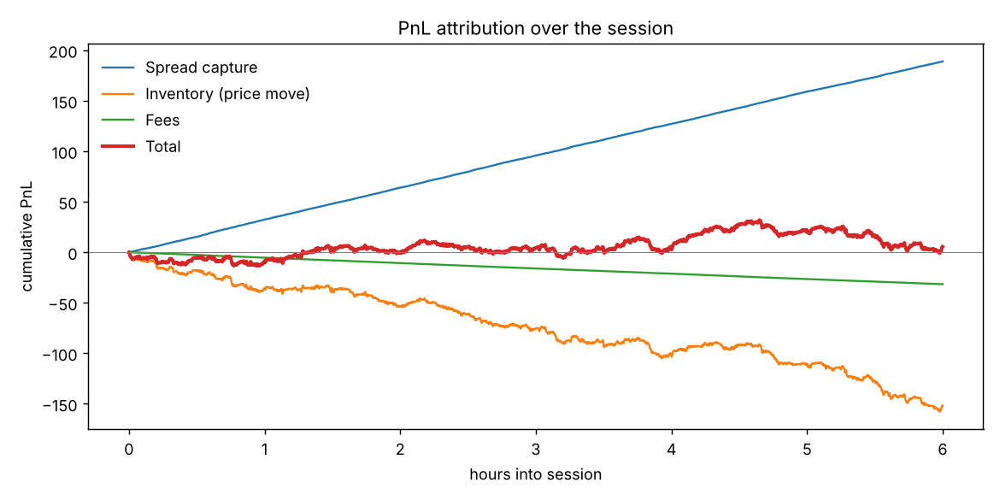
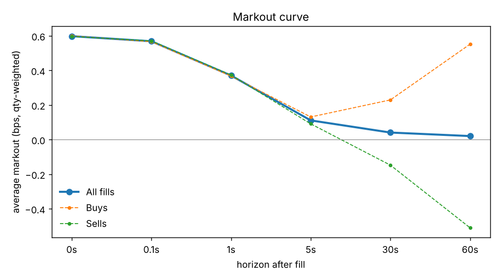
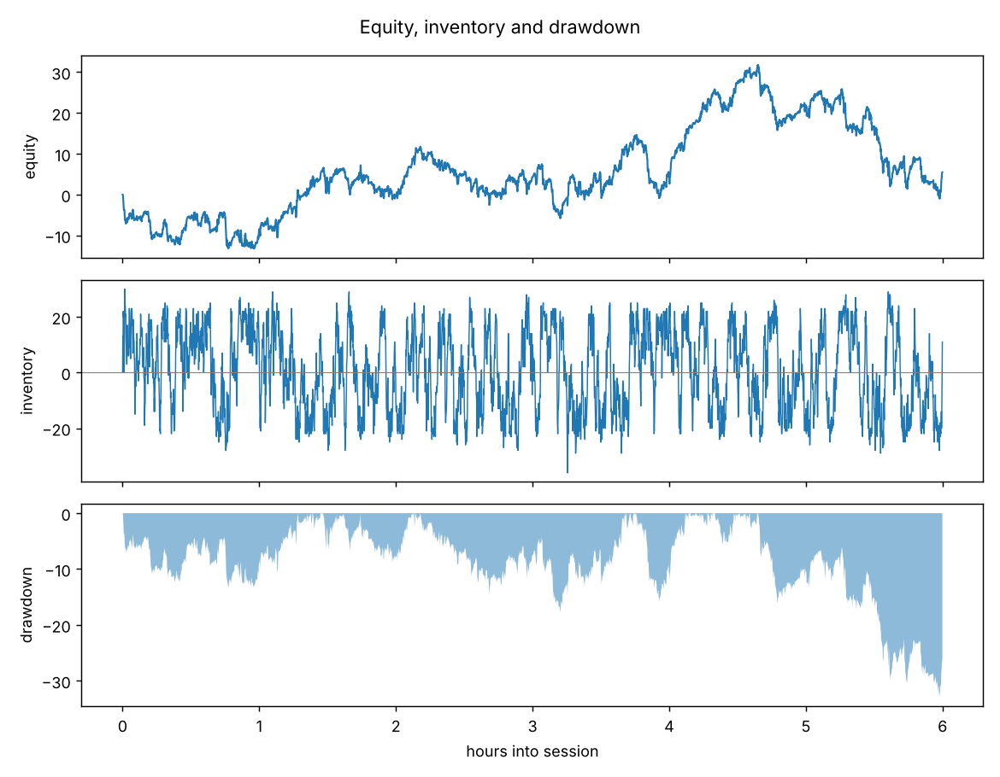

# Post-trade analytics report

Session: 6.0 hours, 15,895 fills, 31,667 units traded,
notional 3,157,541. Marked to the final mid of 101.3150.

## 1. Where did the PnL come from?

| Component | PnL |
|---|---|
| Spread capture (fill price vs mid at fill) | +188.94 |
| Inventory (price move while holding) | -151.95 |
| Fees | -31.58 |
| **Total** | **+5.42** |

The three components sum to the mark-to-market equity at the end of the session
(checked independently in `tests/test_pnl_identity.py`). Total PnL is
+0.017 bps of traded notional.

## 2. Was the edge real? Markouts

Average markout per fill, quantity-weighted, in bps of fill price. The 0s row is
the spread captured against mid; the decay after it is adverse selection.

| horizon | n | avg_bps | avg_bps_buy | avg_bps_sell | adverse_vs_0_bps | pct_positive |
|---|---|---|---|---|---|---|
| 0s | 15,895 | +0.598 | +0.600 | +0.597 | +0.000 | 100.0% |
| 0.1s | 15,895 | +0.569 | +0.567 | +0.571 | -0.029 | 82.5% |
| 1s | 15,895 | +0.371 | +0.368 | +0.374 | -0.228 | 60.2% |
| 5s | 15,890 | +0.111 | +0.131 | +0.091 | -0.487 | 50.5% |
| 30s | 15,867 | +0.041 | +0.230 | -0.147 | -0.557 | 49.5% |
| 60s | 15,852 | +0.021 | +0.552 | -0.510 | -0.578 | 49.8% |

Fills near the end of the session have no markout at the longer horizons and are
excluded from those rows (hence the falling `n`). Long-horizon markouts mix in
whatever the market drifted by, so read them as inventory risk, not as edge.

## 3. Risk and performance

| Metric | Value |
|---|---|
| Max drawdown (1-min bars) | 31.27 |
| Bar PnL mean / std | +0.0151 / 1.8043 |
| Annualised Sharpe (assumes 390 bars/day, 252 days) | 2.62 |
| t-statistic of mean bar PnL | 0.16 |
| Annualised Sortino | 3.41 |
| 1-min VaR 95% / ES 95% | 3.48 / 4.81 |
| 1-min VaR 99% / ES 99% | 5.67 / 6.23 |
| Average / max absolute inventory | 12.6 / 36 |

Treat the annualised Sharpe with care: it scales a few hours of data up to a year.
The t-statistic is the honest signal of whether the mean is distinguishable from
zero; below roughly 2 it is not.

