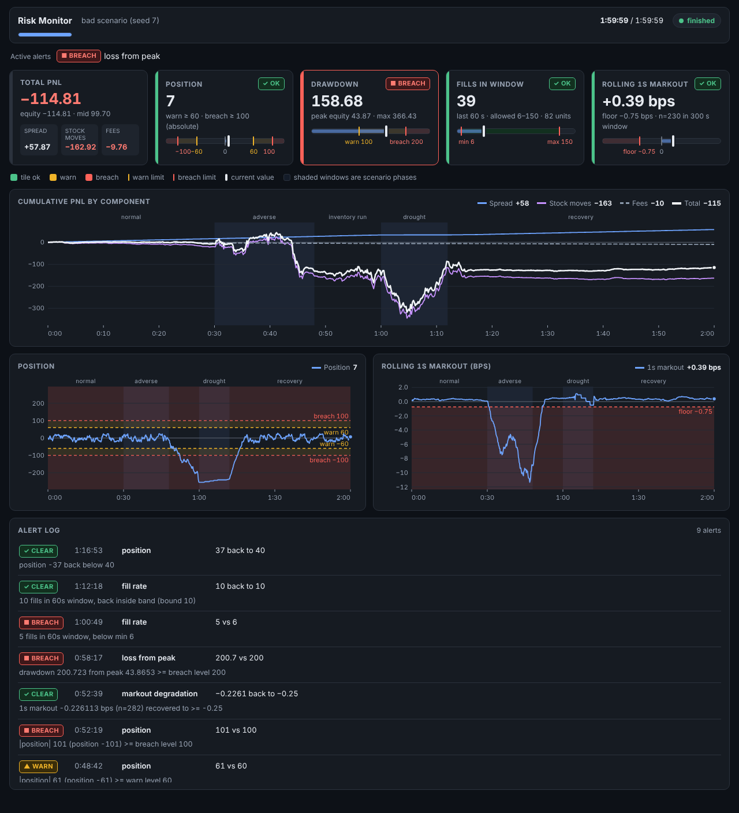

# Risk and strategy monitor

A live monitor that replays fills and quotes, keeps PnL, inventory, drawdown and markouts up to date in O(1) per event, and raises alerts against limits. The data is synthetic, so this shows the monitoring, not a trading edge.



*The dashboard at the end of the injected bad session.*

New to this? A [picture-first explainer](https://claude.ai/artifact/KxGTJVjza6dBftFdujEp7T) covers the approach and architecture with no jargon (private link; source in `../../docs/learning/explainers/project-2.html`).

## What the demo shows

The demo replays one clean session and one bad session, both from seed 7 over 2 hours. The bad session is injected on purpose in five phases: normal, adverse, inventory_run, drought and recovery. Each phase changes the simulator in a known way, so the alerts can be checked against what was injected.

The bad session raises these alerts (`examples/demo_bad.txt`):

```
    t (s)  rule                 severity  value vs threshold  phase
   1836.2  markout_degradation  breach    -0.7666 vs -0.75    adverse
   2646.9  loss_from_peak       warn      100.2 vs 100        adverse
   2922.9  position             warn      61 vs 60            inventory_run
   3139.0  position             breach    101 vs 100          inventory_run
   3159.3  markout_degradation  clear     -0.2261 vs -0.25    inventory_run
   3497.3  loss_from_peak       breach    200.7 vs 200        inventory_run
   3649.4  fill_rate            breach    5 vs 6              drought
   4338.7  fill_rate            clear     10 vs 10            recovery
   4613.4  position             clear     37 vs 40            recovery
```

```
final PnL: total -114.81 = spread 57.87 + stock moves -162.92 - fees 9.76
position 7, max drawdown 366.43, fills 4851
```

The clean session of the same seed (`examples/demo_clean.txt`) raises no alerts. Its final PnL is -6.42, with a position of -23 and a max drawdown of 20.71.

## How it works

The pipeline has four stages:

1. **Replay** (`src/rmon/replay.py`). Merges a Project 1 market frame and fills frame into one ordered stream, with the quote first at equal timestamps. Pacing (`paced`) is a separate wrapper, so the speed setting never changes the results.
2. **State** (`src/rmon/state.py`, `markouts_stream.py`). `MonitorState` keeps cash, fees, position, attribution, equity, peak and drawdown. `MarkoutTracker` resolves each fill's markout at each horizon as the quotes arrive. Each event costs O(1) amortised.
3. **Rules** (`src/rmon/engine.py`, `alerts.py`, `limits.py`). `Engine` wraps the state and evaluates four rules once per committed timestamp: position, loss from peak, fill rate and markout degradation. Limits come from `config/limits.toml`.
4. **Server and page** (`src/rmon/server.py`, `ui/index.html`). A daemon thread steps the engine while HTTP handlers read it under the same lock. The endpoints are `/snapshot.json`, `/history.json`, `/alerts.json` and the page at `/`.

**Batch equivalence.** The incremental numbers equal Project 1's batch numbers: the attribution split, equity at every quote, max drawdown, and per-horizon markouts. `tests/test_equivalence.py` checks that the streaming state reproduces Project 1's batch results exactly.

Three semantic decisions make this exact:

- **Quote before fills at the same timestamp.** A fill stamped on a quote's timestamp uses that quote's mid, so the replay feeds the quote first.
- **Inventory is marked to the current mid.** Project 1 marks to the final mid. At the end of the session the two totals are equal, and at every instant the components still sum to equity.
- **Drawdown is measured once per distinct timestamp.** Transient equity between a quote and the fills that share its timestamp is never a drawdown point, which matches Project 1's `max_drawdown`.

## Alert design

Limits are in `config/limits.toml`. Warn and breach are two levels for position and loss. Fill rate and markout have one breach level each.

| Rule | Metric | Levels | Window and warm-up | Min samples | Hysteresis | Cooldown |
|---|---|---|---|---|---|---|
| `position` | absolute inventory | warn 60, breach 100 | none | none | 20 (clears below 40) | 60 s |
| `loss_from_peak` | peak equity minus equity, currency | warn 100, breach 200 | none | none | 25 (clears below 75) | 300 s |
| `fill_rate` | fills in a rolling window | breach below 6 (drought) or above 150 (runaway) | 60 s window, 120 s warm-up | none | 4 (clears at 10 to 146 fills) | 120 s |
| `markout_degradation` | rolling 1 s markout, bps | breach below -0.75 bps | 300 s window | 50 resolved markouts | 0.5 bps (clears at -0.25 bps or better) | 300 s |

**Cooldown.** Cooldown damps repeats of the same or a lower severity than the last alert. After a fire, a new fire of that severity or lower is suppressed until the cooldown has passed, and it fires on the first evaluation after the cooldown if the condition still holds. A higher severity than the last alert always fires, the same way an escalation while still active skips the cooldown.

**Hysteresis.** Hysteresis sets the recovery threshold on the safe side of the warn level, so the rule does not flap. Between the warn level and the recovery threshold nothing happens. A rule clears only when the metric has recovered past that threshold. In the demo, the markout breach clears at -0.2261 bps against a -0.25 recovery threshold, not at the -0.75 floor. A rule never steps down from breach to warn; it stays at the highest level until it clears.

**False positives against missed breaches.** The thresholds are calibrated on the clean session, which is the simulator's default market and market maker, over seeds 1 to 20 at 2 hours plus seed 7 at 6 hours. No alert at warn or above fires on any of those sessions.

- **Position.** The clean max |position| is 36 across the calibration seeds (the independent review later found 37 on seed 24, which changes nothing). Warn at 60 is 1.67 times that, and it sits above the strategy's own cap of 50 (plus one lot), so a clean session cannot reach it. Breach at 100 is twice the strategy cap, where inventory is no longer under its control.
- **Loss from peak.** The clean max drawdown is 77 (seed 14), and the median is about 20. Warn at 100 is 1.3 times the worst clean value and 5 times the median. Breach at 200 is 2.6 times the worst clean value.
- **Fill rate.** Clean fills per 60 s window, after warm-up, range from 14 to 74 (mean about 44). The minimum of 6 is 8 below the clean minimum, and the comment gives P(fewer than 6 | mean 44) of about 1e-11. The maximum of 150 is twice the clean maximum.
- **Markout.** The clean rolling 1 s markout over 300 s, with at least 50 samples, has a minimum of -0.017 bps over 6 hours and a mean of about +0.37 bps. The floor of -0.75 is 0.73 bps below the worst clean value, and about 1.1 bps below the mean.

Wider limits would fire later on the bad session. Tighter limits would move into the clean margins above. The clean margins come from the same simulator that produced the bad session, so they do not prove the false-positive rate on real flow.

In the bad session, the markout breach fires first, at 1836.2 s, 36.2 s into the adverse phase. The first position warn fires 42.9 s into inventory_run. The fill-rate breach fires 49.4 s into the drought. The loss-from-peak breach fires at 3497.3 s, and the loss rule is still in breach at the end of the session. The loss rule is the one that does not recover: drawdown only clears once it falls below 75 (warn 100 minus hysteresis 25), which needs a real recovery of equity.

## Quickstart

Python 3.11 or newer is required, because the limits loader uses `tomllib`. Run these from this directory.

```bash
pip install -e ../01-post-trade-analytics -e ".[test]"
pytest -q
rmon check-config
rmon demo --scenario bad --out out/bad
rmon demo --scenario clean --out out/clean
rmon serve --scenario bad --speed 600
```

Then open http://127.0.0.1:8765. The server binds to 127.0.0.1 only.

## Layout

```
pyproject.toml                       package metadata, `rmon` entry point, depends on pta (Project 1)
config/limits.toml                   alert limits for the four rules, with calibration notes
src/rmon/__init__.py                 public core and alerting interface
src/rmon/events.py                   Quote and Fill event types
src/rmon/replay.py                   merges quotes and fills into one ordered stream; paced replay
src/rmon/state.py                    incremental PnL attribution, equity, drawdown
src/rmon/markouts_stream.py          streaming markouts per horizon with a rolling window
src/rmon/limits.py                   limits dataclasses, TOML loader and validation
src/rmon/alerts.py                   the four rules and the shared warn/breach/clear state machine
src/rmon/engine.py                   MonitorState plus rules, evaluated once per instant
src/rmon/scenarios.py                clean session and five-phase bad session
src/rmon/server.py                   standard-library HTTP server and replay driver thread
src/rmon/cli.py                      rmon check-config | run | demo | serve
ui/index.html                        dashboard page
examples/demo_bad.txt                output of the bad demo, with alerts and final PnL
examples/demo_clean.txt              output of the clean demo
examples/alerts_bad.jsonl            alert log of the bad session
examples/alerts_clean.jsonl          alert log of the clean session (empty)
examples/screenshot.png              dashboard at the end of the bad session
tests/test_state_edge_cases.py       state edge cases
tests/test_equivalence.py            streaming state vs Project 1 batch results
tests/test_alert_rules.py            each rule on constructed snapshots and small streams
tests/test_config.py                 limits loader accepts the shipped file and rejects bad configs
tests/test_scenario_demo.py          clean session is silent; bad session fires in order
tests/test_cli.py                    check-config exit codes, demo outputs, run reproduces alerts
tests/test_server.py                 live server on an ephemeral port
tests/test_review_regressions.py     regressions from the independent review of the alert layer
```

## How it was checked

- 123 tests pass: core 28, alert layer 61, CLI and server 20, regressions 14.
- An independent review reproduced the incremental numbers against Project 1 on a fresh seed (seed 31). It matched every one of 72,000 equity ticks exactly.
- The review found five problems, all fixed with regression tests:
  - a higher-severity alert hidden by the cooldown after a clear;
  - a mid-instant flush freezing that instant;
  - the bad scenario dropping rows for some hours values;
  - a fill-rate drought followed by a runaway raising no second alert;
  - limits that load but cannot behave.
- The full engine (state plus four rules) processed 231,895 events in 2.1 s on a 6-hour synthetic session. That is about 110,000 events per second, against roughly 10 quotes per second in a live session.
- A 6-hour clean session with seed 7 raises no alerts.

## Limitations and next steps

- **Synthetic data only.** The thresholds are calibrated to this simulator. They need recalibrating on real flow before any use.
- **Loss from peak can stay in breach.** It clears only when drawdown falls below 75 (warn minus hysteresis), which needs equity to recover that far from its peak. In the bad session it is still in breach at the end.
- **No step-down.** A rule never steps down from breach to warn.
- **Markout rule cannot clear during a fill drought.** It keeps its state while fewer than `min_samples` markouts are in its window.
- **No authentication.** The server has no authentication and binds to localhost only.
- **Rounding on CSV.** Alert values written to CSV and read back differ in the last digits.
- **Cosmetic.** The two negative position gauge labels can run together.

## Map to the Graviton Quant Analyst job description

The JD wording below is secondhand, taken from job-board postings, not from the employer's own posting.

| JD wording (secondhand) | Where this project does it |
|---|---|
| build monitoring tools | `src/rmon/engine.py` and `src/rmon/alerts.py` (rules and alert log), served by `src/rmon/server.py` with the page in `ui/index.html` |
| review production trade data | `src/rmon/replay.py` replays fills and quotes in Project 1's schema as a live stream. The input here is synthetic, not production data. |
| scripts in C++ and Python for risk attribution analysis | `src/rmon/state.py` (incremental attribution in Python, reusing Project 1's identity). The C++ kernel lives in Project 1 (`cpp/markout_kernel.cpp`), not here. |
