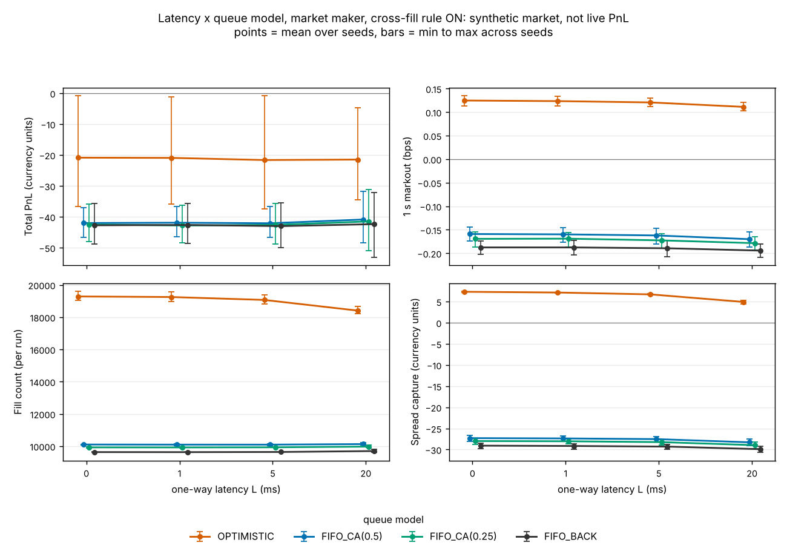
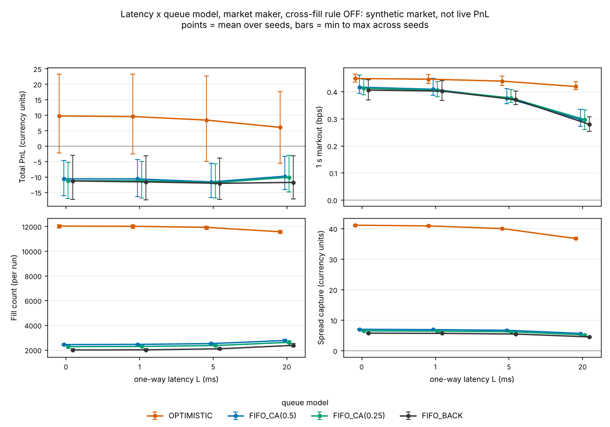

# Project 4: event-driven market-making backtester

An event-driven market-making backtester in C++17, with order latency, cancels in flight and three queue-position models, and a Python sensitivity study. It shows how much optimistic fill assumptions inflate a backtest.

## Read this first

> **The market is synthetic.** Every input comes from Project 3's generator (`tools/gen_feeds.py`), which puts a book on Project 1's simulated price path. Nothing here describes a real venue.
>
> **A backtest is not live PnL.** The simulator has no market impact, does not model how other participants react to our orders, and cannot reproduce real queue dynamics or real latency distributions.
>
> **No project substitutes for a live track record.** Senior HFT postings ask for one (see [firm-landscape](../../docs/firm-landscape.md)).
>
> **The magnitudes are properties of the synthetic market.** The direction of the effect is the finding. The sizes do not transfer to a real venue.
>
> **The cancel-ahead fraction f cannot be identified from this data.** Non-trade decreases at the touch outnumber trades, so the data cannot say what f is. The study shows how results move with f; it does not estimate f (D42).

## Headline result

All numbers come from [`results/sensitivity_table.md`](results/sensitivity_table.md). Each cell is the mean over 3 seeds, each seed 1 hour of synthetic feed.

**(a) Cross-fill rule OFF, 0 ms latency (the ablation).** OPTIMISTIC versus FIFO_BACK:

| metric | OPTIMISTIC | FIFO_BACK |
|---|---|---|
| total PnL (currency units) | +9.71 (seed range -2.26 to 23.30) | -11.31 (seed range -17.33 to -2.99) |
| fills per run | 12,025 | 1,993 |
| 1 s markout (bps) | +0.448 | +0.406 |
| spread capture | +41.10 | +5.73 |

The optimistic model fills about 6 times as often, and its backtest PnL looks positive where the queue-aware model's does not.

**(b) Latency matters once the rule is off.** FIFO_BACK, as latency goes from 0 to 20 ms: the 1 s markout falls from +0.406 to +0.279 bps, spread capture falls from 5.73 to 4.51, and cancels in flight that filled rise from 0 to about 426 per run.

**(c) Cross-fill rule ON (the design's default).** About 76% of FIFO_BACK's fills are cross-rule fills, and spread capture is near -29 (-29.09 at 0 ms). The latency effect is hidden: the same metrics barely move between 0 and 20 ms. Both settings are reported because the rule ON result is dominated by an artefact of one modelling choice, and a study that showed only the default would have told readers that latency does not matter. Showing the rule OFF as well makes the latency effect visible, and it is itself the kind of optimistic inflation this project is meant to expose (D45).


*Study chart with the cross-fill rule ON, the design's default setting.*


*Study chart with the cross-fill rule OFF, which exposes the latency effect.*

## How it works

**Event loop.** Simulated time is Project 3's local capture clock, in nanoseconds, and it never decreases. Events are ordered by `(timestamp, rank, sequence)`. At equal timestamps, market messages come first, then exchange arrivals, then reports to the strategy, then timers. Within the same timestamp and rank, events run in the order they were pushed (D37).

**Latency and the shared channel.** One latency value L applies to order entry, cancel and each ack direction (D38). Orders and cancels travel on one first-in-first-out channel, so a cancel can never overtake the order it cancels. Optional jitter comes from a seeded SplitMix64 generator, and it is the only randomness. With jitter zero, the base models are fully deterministic.

**Cancels in flight.** A cancel takes its latency to reach the exchange, and the order can fill during that time. If the order is fully filled before the cancel arrives, the cancel is rejected as too late. Fills that happen while a cancel is in flight are counted as `cancels_in_flight_filled`.

**Post-only orders.** An order that would cross or lock the market on arrival is rejected (`WOULD_CROSS`). An order that arrives before the book is live is rejected (`BOOK_NOT_LIVE`).

**The cross-fill rule.** The generator moves the touch by deleting and re-adding levels in one message, without printing a trade. A resting order can therefore find the market on the other side of its price. Under the rule (`--cross-fills on`, the default), the order fills once at our own price, kind `CROSS`, and does not fill again from the same liquidity. This is itself an optimistic assumption, because it ignores queue position. `--cross-fills off` removes it for the ablation (D40, D45).

**Three queue models.** All models keep the queue ahead of us, capped at the displayed size.
- **OPTIMISTIC** assumes we are always first in line. Any trade at or through our price fills us, up to our remaining quantity.
- **FIFO_BACK** joins the back of the queue. Only trades at our price advance us. A decrease that cannot be explained by trades must come from ahead of us, and otherwise it is taken from behind us.
- **FIFO_CANCEL_AHEAD(f)** matches FIFO_BACK, except that a fraction f of the unexplained decrease is taken from ahead of us. f = 0 is identical to FIFO_BACK, and tested as such. f is a free parameter that the data cannot identify (D39, D42).

**Market-maker strategy.** This is a port of Project 1's market maker to a real book, with the rules from DESIGN section 4.2:
- It quotes at the market's best bid and best ask.
- Past a skew threshold (`skew_inv`, 20 units by default) it quotes one tick further back on the side it is long, and symmetrically on the other side.
- At the position limit (`max_inv`, 50 units), it pulls the side that would add to the position.
- When the touch moves, it cancels and re-enters in the same callback, cancel first. While the cancel is in flight the old and new orders can both fill, and that exposure is counted.
- A partially filled order at the right price is not topped up.
- It tracks its own position from fill reports, which lag the true position by the ack latency.

**Outputs.** Five files, in Project 1's schema where the schema exists:
- `market.csv` (`ts_us,bid,ask,mid`) is identical to `mdtool export --venue A` on the same feed.
- `fills.csv` (`ts_us,side,px,qty,fee`) is what Project 1 and Project 2 read.
- `fills_detail.csv` has the same rows with the fill kind and queue position, including fills outside the market range.
- `orders.csv` has one row per order, with its status, reject reason and cancel times.
- `summary.csv` is a flat `key,value` run summary, with the counters, the configuration echo and the fill hash.

**Determinism and the fill hash.** The same input and configuration give byte-identical outputs. The fill hash is FNV-1a 64 over the exact bytes of `fills.csv`, header included. It is printed in `summary.csv` as `fills_fnv1a64`, and Python recomputes it in the tests to check the file (DESIGN section 6).

## Quickstart

Run from this directory. You need CMake, a C++17 compiler and Python 3.

```bash
make test             # Release build in build/, then the C++ tests (ctest -R '^bt_')
make test-sanitize    # AddressSanitizer + UBSan build in build-san/, then the C++ tests
make test-python      # builds first, then the Python tests (pytest)
make sensitivity      # the 96-cell study into results/ (needs matplotlib, numpy, pandas)
```

Generate one synthetic feed, normalise it, and run the backtester on it:

```bash
mkdir -p out
python3 ../03-market-data/tools/gen_feeds.py --seed 7 --hours 0.25 --out out/feeds --no-verify
build/md/mdtool normalize --venue A --in out/feeds/venueA.jsonl --out out/events_A.csv
build/bt_run --events out/events_A.csv --out out/run --strategy mm --latency-us 1000 --model fifo_back
```

`bt_run` prints nothing on stdout. On stderr it prints one line, with the fill count, the order count, the fill hash and the wall time.

Feed the outputs to Project 1 and Project 2. Project 1's `pta` is installed with `pip install -e .[test]` in `../01-post-trade-analytics`. Project 2 (`../02-risk-monitor`) provides the `rmon` command.

```bash
pta report --fills out/run/fills.csv --market out/run/market.csv --out out/pta
rmon run --market out/run/market.csv --fills out/run/fills.csv --out out/rmon
```

**CLI limits and exit codes** (from `src/bt_run.cpp`):
- Latency arguments (`--latency-us`, `--entry-latency-us`, `--cancel-latency-us`, `--ack-latency-us`) and `--latency-jitter-us` must be integers from 0 to 1,000,000,000 microseconds (1000 s).
- `--schedule-period-us` must be at least 1 and at most 1,000,000,000. `--schedule-life-us` must be from 0 to 1,000,000,000.
- `--cancel-ahead` is required with `--model fifo_cancel_ahead`, and it is an error otherwise. It takes a decimal from 0 to 1 with at most 6 decimals.
- Exit code 0 means success. Exit code 2 is a usage error. Exit code 3 is an I/O error. Exit code 4 is invalid input. Exit code 5 is a consistency failure, meaning some fills fall outside the market's time range; the output files are still written.

## Layout

```
CMakeLists.txt                     targets, -Wall -Wextra -Werror; Project 3 pulled in EXCLUDE_FROM_ALL
Makefile                           make test, test-sanitize, test-python, sensitivity
DESIGN.md                          frozen design: model definitions, outputs, CLI, test plan
include/bt/types.hpp               OrderId, QueueModel, QueueConfig, Report, Fill, parse helpers
include/bt/event_csv.hpp           reads Project 3's normalised-events CSV, groups messages
include/bt/queue.hpp               the three queue models: arrival, trade and depth updates
include/bt/latency.hpp             SplitMix64, latency config, FIFO channel delays
include/bt/event_queue.hpp         the (ts, rank, seq) event heap
include/bt/strategy.hpp            Strategy interface and the market view
include/bt/strategy_mm.hpp         market maker, port of Project 1's rules
include/bt/strategy_schedule.hpp   fill-independent quoter, used for the ordering test
include/bt/backtest.hpp            exchange, event loop, run_backtest
include/bt/output.hpp              the five output files, FNV-1a hash
src/*.cpp                          one implementation file per header above
src/bt_run.cpp                     bt_run command line
tests/harness.hpp                  minimal TEST/CHECK registry (no gtest)
tests/feed_builder.hpp             builds market messages in code
tests/scripted.hpp                 scripted strategy that records every report
tests/test_queue.cpp               queue models, including the depth rules
tests/test_latency.cpp             latency, FIFO channel, event ordering
tests/test_exchange.cpp            exchange scenarios S1 to S8: queue, cancels in flight, cross, post-only
tests/test_strategy_mm.cpp         market maker rules
tests/test_event_csv.cpp           event CSV parsing
tests/test_backtest.cpp            outputs, golden feed, market.csv equal to Project 3's export
tests/test_determinism.cpp         byte-identical reruns, jitter seeding, ordering property
python/sensitivity.py              the study: runs bt_run over the grid, writes results/
python/test_integration.py         17 Python tests: P1 and P2 integration, determinism, exit codes
python/conftest.py                 pytest fixtures
results/sensitivity_table.md       the study tables and the not-live-PnL statement
results/sensitivity.csv            one row per cell (96 cells)
results/sensitivity.png            chart, cross-fill rule ON
results/sensitivity_cross_off.png  chart, cross-fill rule OFF
results/run_info.txt               how the study was run: seeds, latencies, models, build
```

## Exit criteria (roadmap section 6)

- [x] **Deterministic replays (same seed and inputs give identical fills).** `tests/test_determinism.cpp` (`determinism_two_runs_give_identical_bytes_and_hash`, `determinism_jitter_depends_on_the_seed_only`); `python/test_integration.py` (`test_determinism_bytes_and_hash`). The 96-cell study also reruns byte-identical.
- [x] **Unit tests for queue advancement.** `tests/test_queue.cpp` (`queue_arrival`, `queue_trade`, `queue_depth_*`) and `tests/test_exchange.cpp` (`s1_queue_trajectory_matches_spec_table`, `s1_fifo_back`, `s1_fifo_cancel_ahead_quarter_and_half`).
- [x] **Unit tests for cancels in flight.** `tests/test_exchange.cpp` (`s3a_trade_between_cancel_decision_and_arrival_fills` to `s3e_fifo_back_queue_protects_the_order`, `s4d_cancel_never_overtakes_its_order_on_the_shared_channel`); `tests/test_determinism.cpp` (`market_maker_cancels_in_flight_appear_only_with_latency`).
- [x] **A sensitivity table and chart.** `results/sensitivity_table.md`, `results/sensitivity.png` and `results/sensitivity_cross_off.png`, from `make sensitivity`. `python/test_integration.py` (`test_sensitivity_tiny_grid_is_deterministic`) checks the study's determinism.
- [x] **The write-up states plainly that a backtest is not live PnL.** The "Read this first" box above, and the statement at the end of `results/sensitivity_table.md`, which says the magnitudes do not transfer to a real venue.

## How it was checked

- **C++:** 67 tests pass in the normal build and in the AddressSanitizer + UBSan build, both with `-Werror` and zero warnings.
- **Python:** 17 tests pass, including byte-identical reruns and integration with Projects 1 and 2.
- **Study:** the 96-cell grid (4 latencies x 4 queue models x cross-fill rule on and off x 3 seeds) reruns byte-identical.
- **Independent review** (D46). The reviewer found no flaws in the simulation logic. 5,000 fuzz iterations under the sanitizers covered 515k fills, and a 500-feed model-ordering fuzz found no violation. Three edge cases were fixed: a zero schedule period that looped forever, latency values that overflowed signed 64-bit integers, and two test checks that could never fail. The full study was rerun after the fixes, and its output is unchanged.

## Limitations

- **Synthetic market only.** The feeds, the price path and the touch dynamics all come from Project 3's generator. Its trade rate and its random re-sizing of levels set the sizes of the effects (see the statement in `results/sensitivity_table.md`).
- **One latency value** for entry, cancel and ack. Separate values are not studied.
- **The cross-fill rule is itself queue-less and optimistic.** It is why the default results are dominated by cross fills. Both settings are reported for that reason.
- **The cancel-ahead fraction f is unidentifiable** from this data (D42). The study shows how results move with f, and it does not say what f is.
- **Per-order model ordering is asserted only for a fill-independent schedule** (`ScheduledQuoter`). For the market maker, where fills change later orders, the ordering is reported and not asserted (D41). Totals still come out in model order at every latency.
- **Total PnL is noisy across seeds.** The seed ranges are wide, for example -2.26 to 23.30 for OPTIMISTIC with the rule off. Markout and spread capture are the cleaner signals for latency.
- **Venue A only.** The backtester reads Venue A's normalised events.

## Map to the Graviton Quant Analyst job description

The job-description wording below is secondhand, taken from job-board postings, not from the employer's own posting.

| JD wording (secondhand) | Where this project does it |
|---|---|
| strategy evaluation | `src/backtest.cpp` runs the event loop, `src/strategy_mm.cpp` is the market maker under test, and `python/sensitivity.py` runs the latency x queue x cross-fill study that evaluates it |
| performance breakdowns | `src/output.cpp` writes the per-fill kinds, queue positions and the summary counters; Project 1's `pta` attributes PnL and markouts from `fills.csv` (see `projects/01-post-trade-analytics`) |
| scripts in C++ and Python | `src/bt_run.cpp` (C++ command line) and `python/sensitivity.py` (Python study driver), with `python/test_integration.py` |

## Links

- Decision log: [D36-D46](../../docs/decision-log.md) (reuse of Project 3's book, event ordering, latency, queue models, cross fills, the sensitivity study's ON and OFF settings, and the review fixes).
- Study guide: [docs/learning/STUDY-GUIDE.md](../../docs/learning/STUDY-GUIDE.md).
- Learning notes: [latency and cancels in flight](../../docs/learning/latency-and-cancels-in-flight.md), [queue position and fill models](../../docs/learning/queue-position-and-fill-models.md), [optimistic fills inflate backtests](../../docs/learning/optimistic-fills-inflate-backtests.md).
- Full design: [DESIGN.md](DESIGN.md).
- Project 3, which generates the feeds: [projects/03-market-data](../03-market-data/README.md).
- Project 1, which analyses the fills: [projects/01-post-trade-analytics](../01-post-trade-analytics/README.md).
